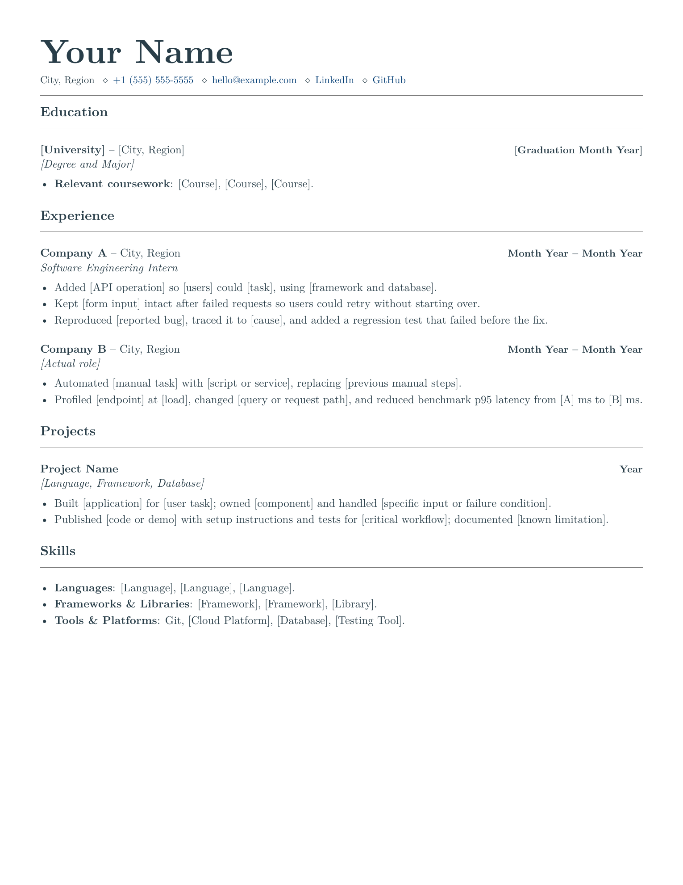

# LaTeX Resume and CV Templates

Resumes for software, AI, and ML engineers, plus a graduate-admissions CV. Edit in Overleaf or build with XeLaTeX.

## Pick a template

| Template | Pages | Edit | Download |
| --- | --- | --- | --- |
| No internship | 1 | [Open in Overleaf](https://www.overleaf.com/docs?snip_uri=https%3A%2F%2Fraw.githubusercontent.com%2Fdeepdave98%2Flatex-resume-and-cv-templates%2Fmain%2Fdownloads%2Fno-internship-resume.zip&engine=xelatex&main_document=resume.tex) | [ZIP](https://raw.githubusercontent.com/deepdave98/latex-resume-and-cv-templates/main/downloads/no-internship-resume.zip) · [PDF](https://raw.githubusercontent.com/deepdave98/latex-resume-and-cv-templates/main/output/pdf/no-internship-resume.pdf) |
| New grad | 1 | [Open in Overleaf](https://www.overleaf.com/docs?snip_uri=https%3A%2F%2Fraw.githubusercontent.com%2Fdeepdave98%2Flatex-resume-and-cv-templates%2Fmain%2Fdownloads%2Fnew-grad-resume.zip&engine=xelatex&main_document=resume.tex) | [ZIP](https://raw.githubusercontent.com/deepdave98/latex-resume-and-cv-templates/main/downloads/new-grad-resume.zip) · [PDF](https://raw.githubusercontent.com/deepdave98/latex-resume-and-cv-templates/main/output/pdf/new-grad-resume.pdf) |
| Experienced | 1 | [Open in Overleaf](https://www.overleaf.com/docs?snip_uri=https%3A%2F%2Fraw.githubusercontent.com%2Fdeepdave98%2Flatex-resume-and-cv-templates%2Fmain%2Fdownloads%2Fexperienced-resume.zip&engine=xelatex&main_document=resume.tex) | [ZIP](https://raw.githubusercontent.com/deepdave98/latex-resume-and-cv-templates/main/downloads/experienced-resume.zip) · [PDF](https://raw.githubusercontent.com/deepdave98/latex-resume-and-cv-templates/main/output/pdf/experienced-resume.pdf) |
| AI engineer | 1 | [Open in Overleaf](https://www.overleaf.com/docs?snip_uri=https%3A%2F%2Fraw.githubusercontent.com%2Fdeepdave98%2Flatex-resume-and-cv-templates%2Fmain%2Fdownloads%2Fai-engineer-resume.zip&engine=xelatex&main_document=resume.tex) | [ZIP](https://raw.githubusercontent.com/deepdave98/latex-resume-and-cv-templates/main/downloads/ai-engineer-resume.zip) · [PDF](https://raw.githubusercontent.com/deepdave98/latex-resume-and-cv-templates/main/output/pdf/ai-engineer-resume.pdf) |
| ML engineer | 1 | [Open in Overleaf](https://www.overleaf.com/docs?snip_uri=https%3A%2F%2Fraw.githubusercontent.com%2Fdeepdave98%2Flatex-resume-and-cv-templates%2Fmain%2Fdownloads%2Fml-engineer-resume.zip&engine=xelatex&main_document=resume.tex) | [ZIP](https://raw.githubusercontent.com/deepdave98/latex-resume-and-cv-templates/main/downloads/ml-engineer-resume.zip) · [PDF](https://raw.githubusercontent.com/deepdave98/latex-resume-and-cv-templates/main/output/pdf/ml-engineer-resume.pdf) |
| Graduate admissions | 1 (starter) | [Open in Overleaf](https://www.overleaf.com/docs?snip_uri=https%3A%2F%2Fraw.githubusercontent.com%2Fdeepdave98%2Flatex-resume-and-cv-templates%2Fmain%2Fdownloads%2Fgraduate-admissions-resume.zip&engine=xelatex&main_document=resume.tex) | [ZIP](https://raw.githubusercontent.com/deepdave98/latex-resume-and-cv-templates/main/downloads/graduate-admissions-resume.zip) · [PDF](https://raw.githubusercontent.com/deepdave98/latex-resume-and-cv-templates/main/output/pdf/graduate-admissions-resume.pdf) |

Start with **New grad** if you have an internship, or **No internship** if projects are your strongest work. **Experienced** puts work first; keep only the roles you need. All starters begin at one page. Use a second page when the content warrants it. For admissions, follow the program's length requirements.

For AI or ML jobs, use the role starter when its work matches yours; move education and projects first if you are a student or new grad.

[All previews](output/pdf/README.md) · [Section order](docs/section-order.md) · [AI/ML guide](docs/ai-ml-resumes.md) · [Admissions guide](docs/graduate-admissions.md).



## Edit the content

1. Open a template above, or upload its ZIP to Overleaf. Select **XeLaTeX** and `resume.tex`.
2. Replace contacts, education, and sample work in `resume.tex`. The bullets are prompts, not a checklist of things you must have done. Delete unused entries.
3. Recompile. Check placeholder warnings, every page, and the PDF's links. Warnings can miss unfinished text.

[Editing reference](docs/editing.md) · [Bullet examples](examples/engineering-bullets.md) · [Before you send](docs/before-you-send.md). Styling lives in `resume.cls`.

## Build locally

[Install XeLaTeX and latexmk](docs/local-setup.md), then run inside an extracted starter:

```bash
latexmk resume.tex
```

Output: `resume.pdf`. In a clone, `make` builds all starters to `build/`.

## Optional tools

- **[PDF reviewer](https://raw.githubusercontent.com/deepdave98/latex-resume-and-cv-templates/main/downloads/pdf-review.zip):** unzip and open `pdf-review.html`. Inspect pages, text, and links; check upload limits or edit a text copy for application forms. Works offline; the PDF stays unchanged. [Limits and privacy](tools/pdf-review/README.md).
- **[Application versions](examples/application-versions/README.md):** keep contacts, projects, education, and optional work history in shared files. Start with a base resume and choose different bullets for each application. Includes steps for moving an existing resume. [Overleaf](https://www.overleaf.com/docs?snip_uri=https%3A%2F%2Fraw.githubusercontent.com%2Fdeepdave98%2Flatex-resume-and-cv-templates%2Fmain%2Fdownloads%2Fapplication-versions.zip&engine=xelatex&main_document=resume.tex) · [ZIP](https://raw.githubusercontent.com/deepdave98/latex-resume-and-cv-templates/main/downloads/application-versions.zip) · [Base PDF](https://raw.githubusercontent.com/deepdave98/latex-resume-and-cv-templates/main/output/pdf/application-resume.pdf) · [Backend PDF](https://raw.githubusercontent.com/deepdave98/latex-resume-and-cv-templates/main/output/pdf/application-backend.pdf).

[Contribute](CONTRIBUTING.md) · [Tests](tests/README.md) · [MIT License](LICENSE) · [Report a security issue privately](https://github.com/deepdave98/latex-resume-and-cv-templates/security/advisories/new).
