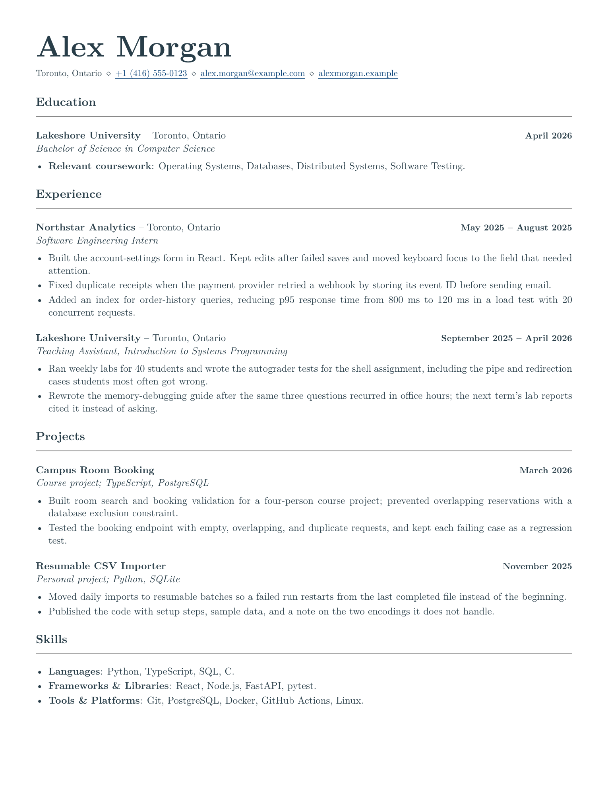

# LaTeX Resume and CV Templates

One-page resumes for software, AI, and ML engineers, a graduate-admissions CV, and a matching cover letter. Edit in Overleaf with one click or build with XeLaTeX.



The PDF is one column of real text with embedded fonts, no icons, and no photo, so the text a parser extracts matches the page. The compile log reminds you about sample text you have not replaced, warns when the resume runs past its page budget, and links your email and phone automatically. [Example PDF](https://raw.githubusercontent.com/deepdave98/latex-resume-and-cv-templates/main/output/pdf/new-grad-example.pdf) · [Example source](examples/new-grad-example.tex).

## Pick a template

- **No internship** (education, projects, other experience): [Overleaf](https://www.overleaf.com/docs?snip_uri=https%3A%2F%2Fraw.githubusercontent.com%2Fdeepdave98%2Flatex-resume-and-cv-templates%2Fmain%2Fdownloads%2Fno-internship-resume.zip&engine=xelatex&main_document=resume.tex) · [ZIP](https://raw.githubusercontent.com/deepdave98/latex-resume-and-cv-templates/main/downloads/no-internship-resume.zip) · [PDF](https://raw.githubusercontent.com/deepdave98/latex-resume-and-cv-templates/main/output/pdf/no-internship-resume.pdf)
- **New grad** (education, internship, projects): [Overleaf](https://www.overleaf.com/docs?snip_uri=https%3A%2F%2Fraw.githubusercontent.com%2Fdeepdave98%2Flatex-resume-and-cv-templates%2Fmain%2Fdownloads%2Fnew-grad-resume.zip&engine=xelatex&main_document=resume.tex) · [ZIP](https://raw.githubusercontent.com/deepdave98/latex-resume-and-cv-templates/main/downloads/new-grad-resume.zip) · [PDF](https://raw.githubusercontent.com/deepdave98/latex-resume-and-cv-templates/main/output/pdf/new-grad-resume.pdf)
- **Experienced** (work history, with a promotion pattern): [Overleaf](https://www.overleaf.com/docs?snip_uri=https%3A%2F%2Fraw.githubusercontent.com%2Fdeepdave98%2Flatex-resume-and-cv-templates%2Fmain%2Fdownloads%2Fexperienced-resume.zip&engine=xelatex&main_document=resume.tex) · [ZIP](https://raw.githubusercontent.com/deepdave98/latex-resume-and-cv-templates/main/downloads/experienced-resume.zip) · [PDF](https://raw.githubusercontent.com/deepdave98/latex-resume-and-cv-templates/main/output/pdf/experienced-resume.pdf)
- **AI engineer** (applied AI work, with evaluation details): [Overleaf](https://www.overleaf.com/docs?snip_uri=https%3A%2F%2Fraw.githubusercontent.com%2Fdeepdave98%2Flatex-resume-and-cv-templates%2Fmain%2Fdownloads%2Fai-engineer-resume.zip&engine=xelatex&main_document=resume.tex) · [ZIP](https://raw.githubusercontent.com/deepdave98/latex-resume-and-cv-templates/main/downloads/ai-engineer-resume.zip) · [PDF](https://raw.githubusercontent.com/deepdave98/latex-resume-and-cv-templates/main/output/pdf/ai-engineer-resume.pdf)
- **ML engineer** (training, data splits, and serving): [Overleaf](https://www.overleaf.com/docs?snip_uri=https%3A%2F%2Fraw.githubusercontent.com%2Fdeepdave98%2Flatex-resume-and-cv-templates%2Fmain%2Fdownloads%2Fml-engineer-resume.zip&engine=xelatex&main_document=resume.tex) · [ZIP](https://raw.githubusercontent.com/deepdave98/latex-resume-and-cv-templates/main/downloads/ml-engineer-resume.zip) · [PDF](https://raw.githubusercontent.com/deepdave98/latex-resume-and-cv-templates/main/output/pdf/ml-engineer-resume.pdf)
- **Graduate admissions** (education, research, teaching): [Overleaf](https://www.overleaf.com/docs?snip_uri=https%3A%2F%2Fraw.githubusercontent.com%2Fdeepdave98%2Flatex-resume-and-cv-templates%2Fmain%2Fdownloads%2Fgraduate-admissions-resume.zip&engine=xelatex&main_document=resume.tex) · [ZIP](https://raw.githubusercontent.com/deepdave98/latex-resume-and-cv-templates/main/downloads/graduate-admissions-resume.zip) · [PDF](https://raw.githubusercontent.com/deepdave98/latex-resume-and-cv-templates/main/output/pdf/graduate-admissions-resume.pdf)

Every ZIP also contains `cover-letter.tex` with the same header. [Open the cover letter in Overleaf](https://www.overleaf.com/docs?snip_uri=https%3A%2F%2Fraw.githubusercontent.com%2Fdeepdave98%2Flatex-resume-and-cv-templates%2Fmain%2Fdownloads%2Fnew-grad-resume.zip&engine=xelatex&main_document=cover-letter.tex) · [PDF](https://raw.githubusercontent.com/deepdave98/latex-resume-and-cv-templates/main/output/pdf/cover-letter.pdf).

Start with **New grad** if you have an internship, or **No internship** if projects are your strongest work. All starters begin at one page. If relevant work needs a second, the footer prints your name and page number from page 2. For admissions, follow the program's length rules.

[Section order](docs/section-order.md) · [AI/ML guide](docs/ai-ml-resumes.md) · [Admissions guide](docs/graduate-admissions.md) · [All previews](output/pdf/README.md)

## Edit the content

1. Open a template above. Overleaf imports the ZIP; select **XeLaTeX** and `resume.tex`.
2. Replace the header, education, and sample work. The bullets are prompts, not a checklist of things you must have done. Delete unused entries.
3. Recompile. The log names each unreplaced placeholder and warns above the page budget. Read every page and click the links in the PDF.

The [editing reference](docs/editing.md) covers contacts, promotions, the cover letter, fonts, colors, and paper size. [Bullet examples](examples/engineering-bullets.md) show how to turn notes into specific bullets. [Before you send](docs/before-you-send.md) is the final checklist.

## Build locally

[Install XeLaTeX and latexmk](docs/local-setup.md), then run inside an extracted ZIP:

```bash
latexmk resume.tex
```

In a clone, `make` builds every document to `build/` and `make doctor` checks dependencies. [](https://github.com/deepdave98/latex-resume-and-cv-templates/actions/workflows/build.yml) Every change compiles all six starters, the cover letter, and the example on a pinned TeX Live image, checks that each stays on one page and that contact links point where the text says, compares each starter's extracted text with a reviewed baseline, and checks the ZIPs against their sources. `make test` runs the same checks.

## Optional tools

- **[PDF reviewer](https://raw.githubusercontent.com/deepdave98/latex-resume-and-cv-templates/main/downloads/pdf-review.zip):** unzip and open `pdf-review.html` to read the text a parser extracts from your PDF and check where each link goes. Works offline; nothing leaves your browser. [Details](tools/pdf-review/README.md).
- **[Application versions](examples/application-versions/README.md):** keep facts in one place and choose entries and bullets per application. [Overleaf](https://www.overleaf.com/docs?snip_uri=https%3A%2F%2Fraw.githubusercontent.com%2Fdeepdave98%2Flatex-resume-and-cv-templates%2Fmain%2Fdownloads%2Fapplication-versions.zip&engine=xelatex&main_document=resume.tex) · [ZIP](https://raw.githubusercontent.com/deepdave98/latex-resume-and-cv-templates/main/downloads/application-versions.zip) · [Base PDF](https://raw.githubusercontent.com/deepdave98/latex-resume-and-cv-templates/main/output/pdf/application-resume.pdf) · [Backend PDF](https://raw.githubusercontent.com/deepdave98/latex-resume-and-cv-templates/main/output/pdf/application-backend.pdf).

[Contribute](CONTRIBUTING.md) · [Tests](tests/README.md) · [MIT License](LICENSE) · [Report a security issue privately](https://github.com/deepdave98/latex-resume-and-cv-templates/security/advisories/new).
